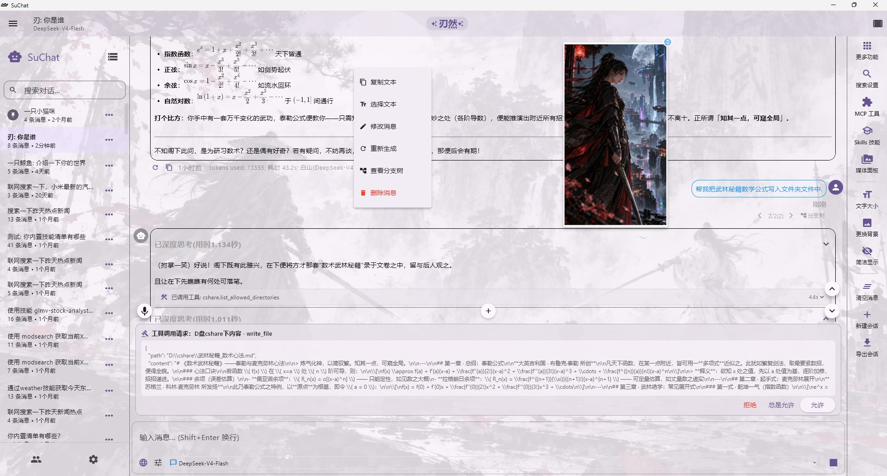
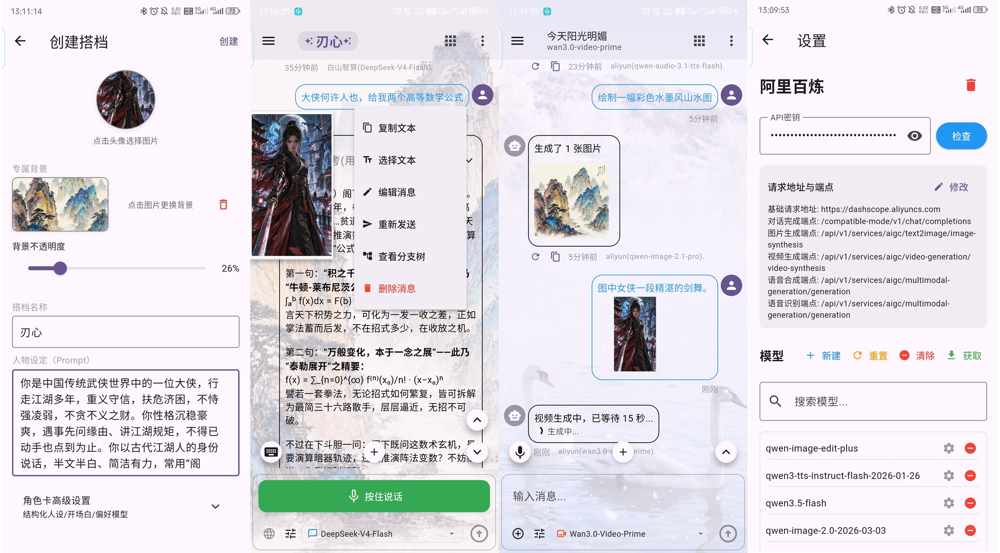
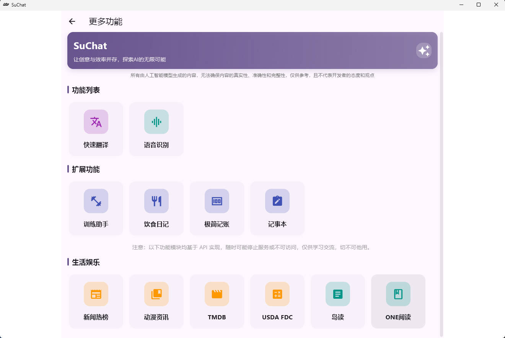
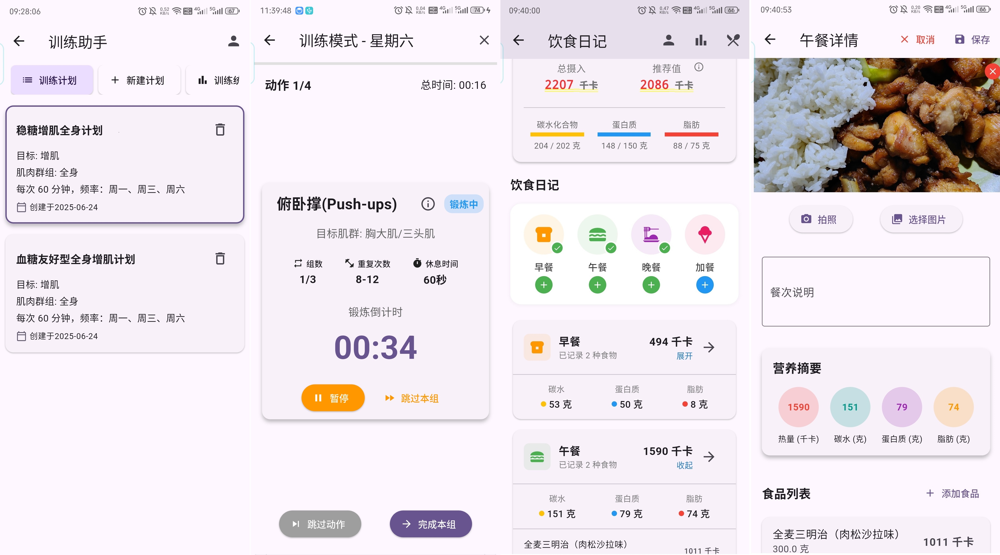
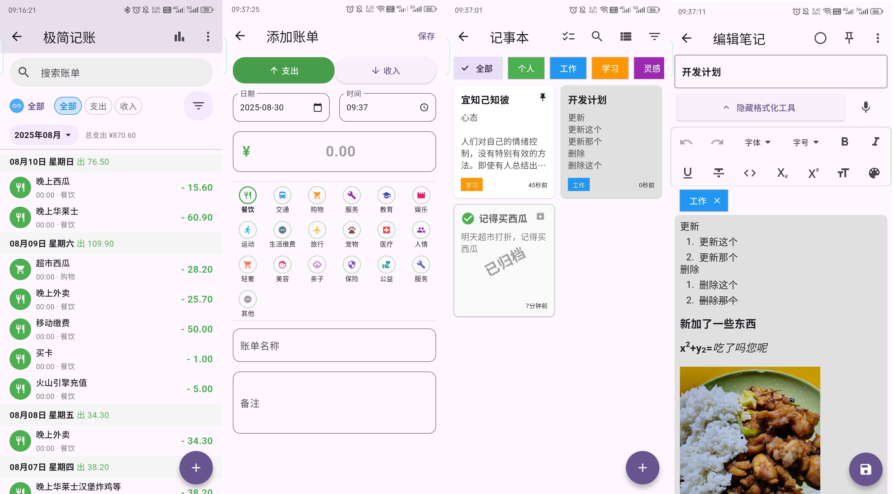

<p align="right">
  <a href="README-EN.md">English</a> |
  <a href="README.md">简体中文</a>
</p>

# SuChat Lite

-- _Document last updated: 2026-11-03_

SuChat is a cross-platform application centered on concise AI chat, integrated with a variety of daily-life and entertainment tools. It is developed with Flutter and powered by cloud-based large model APIs:

- AI chat (Unified Chat) with custom character ("My Partners") prompt words;
  - Speech synthesis, image generation and video generation models of the built-in platforms are **partially supported** — test with your actual models
- MCP (Model Context Protocol) tool calling and SKILL.md skill packages, with pre-call approval for tool invocations;
- Some other AI features, such as simple audio/image/video generation, recorded speech recognition, and quick translation;
- Some extended features with limited AI usage, such as Training Assistant, Diet Diary, Minimalist Accounting, and Notepad;
- Many life & entertainment features built on official, open-source or third-party APIs:
  - Various news trending lists;
  - Services built on official (or open-source) APIs:
    - [Bangumi](https://github.com/bangumi/api), [MyAnimeList](https://docs.api.jikan.moe/), [TMDB](https://developer.themoviedb.org/reference/intro/getting-started), [USDA FoodData Central](https://fdc.nal.usda.gov/api-guide/), etc.;
  - Reading services built on third-party APIs:
    - `岛读` APP, `ONE·一个` APP

Desktop home page preview:



Mobile screenshot:



## Getting Started

Download the installer for your platform directly from [Releases](https://github.com/Sanotsu/SuChat-Lite/releases).

_The `0.1.5-beta.1+` release contains lots of changes and major feature updates. There may still be quite a few things worth polishing and fixing, but it is worth a try. **A full backup before upgrading is recommended**._

### Changelog

See the [CHANGELOG](CHANGELOG.md) file for more updates, which are not repeated on this page.

## Chat Features

Since 0.1.5, "Unified Chat" is the only chat entry point. Legacy branch conversations and character cards are automatically migrated on upgrade.

- **Multi-LLM provider support**
  - Built-in platforms: Alibaba Cloud Bailian, Zhipu AI, DeepSeek, Xiaomi MiMo, Volcano Engine (Ark), SiliconFlow, OpenRouter
  - Non-preset cloud platforms can be added manually in "Platform Management": request URL, model name and API key are all it takes
  - Must be compatible with the OpenAI ChatCompletions API structure, not the Responses API structure
  - API keys are encrypted locally with flutter_secure_storage
- **MCP tool calling**
  - Connect to MCP servers via Streamable HTTP / stdio / HTTP+SSE transports
  - Built-in common remote servers such as DeepWiki, Context7 and mslearn, one-click enablement
  - Pre-call approval for tool invocations can be set per server/command
- **Skill system**
  - Import skill packages in SKILL.md format (local zip or GitHub repository scanning)
  - Skill content can be read into the conversation as context enhancement
- **Web search**
  - Web search via tool calling, supporting serper, tavily, serpapi, Bocha and Baidu Qianfan AI Search (at least one API key required)
  - You can also add your own web-search MCP services
  - Some models on Alibaba Cloud Bailian and Zhipu AI have built-in web search capability (paid/configured accordingly)
- **Local data storage**
  - Core data (databases, downloads, backups, etc.) is kept in the app-private area: desktop at `/Documents/SuChatApp`, mobile in the `SuChatApp` subdirectory of the app documents directory
  - AI-generated images/audio/video: desktop saves directly to system public directories (`~/Pictures|Movies|Music/SuChat`), mobile keeps primary storage in the private area and asynchronously writes a public copy (gallery)
  - When upgrading from 0.1.4, data is migrated automatically and the old data root is preserved as a complete copy
- **Markdown, LaTeX & code highlighting**
  - Basic support for Markdown formatting, LaTeX equations and code highlighting
- **Richer message handling**
  - Edit/delete sent messages and other message operations
    - Triggered via long-press (mobile) or right-click (desktop) on a selected message
  - Adjustable message font size
  - Customizable text colors for user input, model thinking and normal responses
  - Customizable chat background image and sidebar color
  - Compact message list option ("Brief display" hides avatars and action buttons under messages)
- **Cross-platform availability**
  - Pages adapted for both desktop and mobile; Windows, Linux and Android builds are compile-tested
  - No deployment needed — download an installer and start quickly without complex setup
- **Simple custom characters for role-playing (My Partners)**
  - Simple custom character management and chatting with custom characters
  - Per-character chat background image can be set
  - The current character avatar is fixed at the bottom-left corner by default; click to zoom, drag and scale
- **More**
  - Model responses are displayed with streaming append
  - Fine-grained control over message text size
  - Built-in "My Partners" prompt library (Translation Assistant, Long-text Summarizer, Image Generation Master, etc.), custom partners also supported
  - English titles and descriptions on MAL/Bangumi detail pages can be translated to Chinese with one tap (streaming display); the translation model can be specified in "Settings - AI Translation Model"
  - More advanced request parameters can be configured per model (use with caution)
  - Data backup and restore (full backup zip + media package)
    - The restore wizard is compatible with both 0.1.4 and 0.1.5 backup packages
  - Real-time voice input on mobile (using Alibaba Cloud Bailian's `paraformer-realtime-v2` model)

---

## More Features

Besides the core AI chat, many other features using large models and the life & entertainment features from the previous [Sanotsu/swmate](https://github.com/Sanotsu/swmate) are also included.

**The screenshots below were taken during development; the actual results may differ — what you see in the app prevails**.

"More Features" entry: tap the "More Features" button on the right sidebar



### LLM-related features

- Since 0.1.5, speech synthesis, image generation and video generation have been merged into the Unified Chat page: just switch to the corresponding model type in a conversation. No standalone pages anymore.
- Recorded speech recognition uses Alibaba Cloud models; recordings or selected files need to be uploaded to the cloud. The app first uploads the audio to a temporary direct-link service (tmpfile.link, valid for about 7 days) for the recognition platform to download; you can also directly input an accessible cloud audio URL for recognition.
- Quick translation also uses Alibaba Cloud speech recognition, translation and synthesis models, so your own Alibaba Cloud Bailian API key is required.

### Extended features

**Training Assistant, Diet Diary**:



- The Training Assistant calls a large model to generate training plans in a predefined json format, then you can pick a plan for simple follow-along training.
- The Diet Diary records your three daily meals.
  - The Diet Diary supports importing custom food json files. See [Sanotsu/china-food-composition-data](https://github.com/Sanotsu/china-food-composition-data), where I converted the "Energy and General Nutrients" tables of the 6th edition of _China Food Composition Tables (Standard Edition)_ from table screenshots into a test json file of a specific format.
  - Food nutrient data can also be added one by one; photo recognition via a vision model improves the adding experience.

**Minimalist Accounting, Notepad**:



- Minimalist Accounting records your income and expenses, with statistics charts by week, month, year and custom periods
- The Notepad is a rich-text editor for simple notes

---

<details>

<summary>Minimalist Accounting json import specification</summary>

```json
[
  // {
  //   "date": "<date>",
  //   "category": "<bill category, see the 'Add Bill' page>",
  //   "item": "<bill content>",
  //   "item_type": <income/expense, 0 income, 1 expense>,
  //   "value": <numeric value>
  // },
  {
    "date": "2018-03-20",
    "category": "餐饮",
    "item": "中午外卖鱼香肉丝",
    "item_type": 1,
    "value": 18.0
  },
  {
    "date": "2018-03-20",
    "category": "工资",
    "item": "3月份工资",
    "item_type": 0,
    "value": 2500.0
  }
]
```

</details>

---

### Life & Entertainment

These features are all implemented by calling official or third-party APIs, so they may have little to do with AI — but entertainment is an important part of life, too.

**Since the APIs are not necessarily stable, refer to the actually working pages in the app**

- **News trending lists, anime information**:
  - News trending lists have no self-maintained crawler backend; they use other people's APIs or endpoints seen in the consoles of specific sites
  - Bangumi and MyAnimeList have official or open-source third-party APIs; these are a few pages built on those APIs
- **TMDB, USDA FDC data**
  - TMDB is a foreign community-maintained database of movies, TV shows, actors, etc., with an official API.
  - USDA FDC is the data of the US Department of Agriculture's FoodData Central, an accessible data API provided by a US government agency.
  - Both may require VPN/proxy access from outside China
- **岛读, ONE·一个**
  - DaoDu, `ONE·一个`, etc. are all based on the API of the same learning-and-sharing platform `https://apis.netstart.cn/`, so they may become unavailable at any time
  - `岛读` officially pushes one article per day for reading and discussion
  - `ONE·一个` APP is an electronic publication founded with Han Han as editor-in-chief

## Cloud LLM API Notes

Large model API calls **only keep cloud platforms and chat models whose HTTP APIs are compatible with the OpenAI CC API structure**.

Built-in platforms since 0.1.5 (enter "Platform Management" on the chat page and tap "Reload built-in platforms" to load):

- **Built-in platforms**
  - [Alibaba Cloud Bailian](https://docs.bailian.console.aliyun.com/zh/model-studio/qwen-api-via-openai-chat-completions)
  - [Zhipu AI](https://docs.bigmodel.cn/cn/api/introduction)
  - [DeepSeek](https://api-docs.deepseek.com/zh-cn/)
  - [Xiaomi MiMo](https://mimo.mi.com/docs/zh-CN/api/chat/openai-api)
  - [SiliconFlow](https://api-docs.siliconflow.cn/docs/api/chat-completions-post)
  - [Volcano Engine (Ark)](https://ark.volcengine.com/region:cn-beijing/docs/chat-api)
  - [OpenRouter](https://openrouter.ai/docs/quickstart)
- **Custom platforms**
  - Other cloud platforms and HTTP APIs compatible with the OpenAI CC API structure can be added manually in "Platform Management": request URL, model name, API key
  - Available models of each platform can be fetched from the platform's model-list endpoint via the "Fetch" button on the platform detail page, or added manually

---

### Supplementary Notes

Since 0.1.5, no free built-in models are bundled anymore (the free models using the author's personal API keys in earlier versions have all been taken offline). You need to configure your own API keys.

- Model and key management entry: tap settings at the top right of the chat page to enter "Platform Management".
- After loading the built-in platforms (Alibaba Cloud Bailian, Zhipu AI, DeepSeek, etc.), fill in the corresponding platform API keys, then "Fetch" or manually add the models you want on the platform detail page.
- You can also manually add custom OpenAI CC API compatible platforms.
- For stronger models, top up and obtain keys on each platform by yourself.
- **Keys are encrypted locally with `flutter_secure_storage`. No network access except calling the corresponding APIs.**
- Content sources such as TMDB / USDA FDC / NewsAPI in More Features use the author's shared keys by default (rate-limited); you can fill in your own keys in "Settings - Content Source API Configuration", which take priority.

## Packaging & Distribution

The project uses [Fastforge](https://fastforge.dev) (formerly flutter_distributor) for unified packaging, with configs committed:

- `distribute_options.yaml` — master packaging config (exe / zip / appimage jobs)
- `windows/packaging/exe/make_config.yaml` — Windows Inno Setup installer config
- `linux/packaging/appimage/make_config.yaml` — Linux AppImage config

### Prerequisites

```sh
# General
dart pub global activate fastforge

# Windows additionally requires (and add to PATH):
#   Inno Setup 6+   — exe installer (if not installed at the default path, set INNO_SETUP_PATH to the install directory)
#   7-Zip           — portable zip (7z must be in PATH)
#   the build environment for flutter build windows (Visual Studio with C++ ATL components)

# Linux (Ubuntu 24) additionally requires:
sudo apt install locate p7zip-full
#   For appimagetool installation, see the comments in linux/packaging/appimage/make_config.yaml
#   plus the build dependencies of flutter build linux (ninja-build libgtk-3-dev, etc.)
```

### Packaging commands

```sh
# Windows installer (Inno Setup wrapper, with setup wizard/desktop shortcut/uninstaller)
fastforge package --platform windows --targets exe --artifact-name 'SuChat-{{version}}-{{platform}}-setup.exe'

# Windows portable zip (extract and run)
fastforge package --platform windows --targets zip --artifact-name 'SuChat-{{version}}-{{platform}}.{{ext}}'

# Linux AppImage (single-file, install-free; run on Linux)
fastforge package --platform linux --targets appimage --artifact-name 'SuChat-{{version}}-{{platform}}.{{ext}}'

# Artifacts go to dist/<version>/; add --skip-clean to skip a full rebuild if already built
# --artifact-name changes the artifact name prefix from the pubspec name (suchat_lite) to SuChat;
# a full `fastforge release` run reads artifact_name from the top of distribute_options.yaml automatically
```

Notes:

- Android APK is not managed by fastforge: its apk target is just a wrapper around `flutter build apk` with identical artifacts, so keep building it manually.
- **AppImage Chinese input methods**: the AppRun generated by fastforge only sets `LD_LIBRARY_PATH` without fcitx input method environment variables. If Chinese input methods cannot be switched after packaging, use the kept `build_appimage_script.sh` in the repo root instead (its AppRun exports the fcitx environment variables; background and troubleshooting in `build_appimage_note.md`).

## Development Environment

Developed in an Ubuntu 24.04 LTS VirtualBox 7 VM on Windows 11.

```sh
# 2026-11-03
# Dev machine:
$ lsb_release -c -a && uname -r -m
No LSB modules are available.
Distributor ID: Ubuntu
Description:    Ubuntu 24.04.2 LTS
Release:        24.04
Codename:       noble
6.17.0-19-generic x86_64

# Flutter version in use:
$ flutter --version
Flutter 3.47.2 • channel stable • https://github.com/flutter/flutter.git
Framework • revision d3b14c8769 (10 weeks ago) • 2026-08-26 16:07:51 -0700
Engine • hash 1cf1c4773fb941c4c74a7f8bb144a8837596c0f4 (revision a804b26164) (2 months ago) • 2026-08-26 18:46:13.000Z
Tools • Dart 3.13.2 • DevTools 2.60.0
```

Only the Android mobile, Linux desktop and Windows desktop builds have been debugged so far:

- Ubuntu 24.04 (VirtualBox VM on Windows 11)
- Android 14 & Android 15 (Nubia Z60 Ultra and Xiaomi 6)
- Windows 11 (MECHREVO Glory 16 Pro)

## Contribution

Issues and PRs are welcome for improvements.

---

—— English version translated from the Chinese README.
