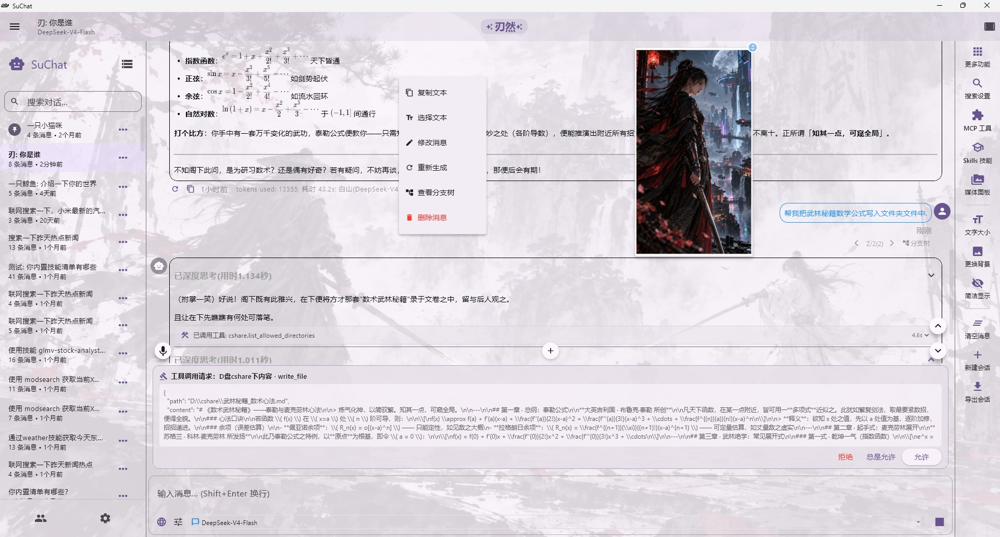
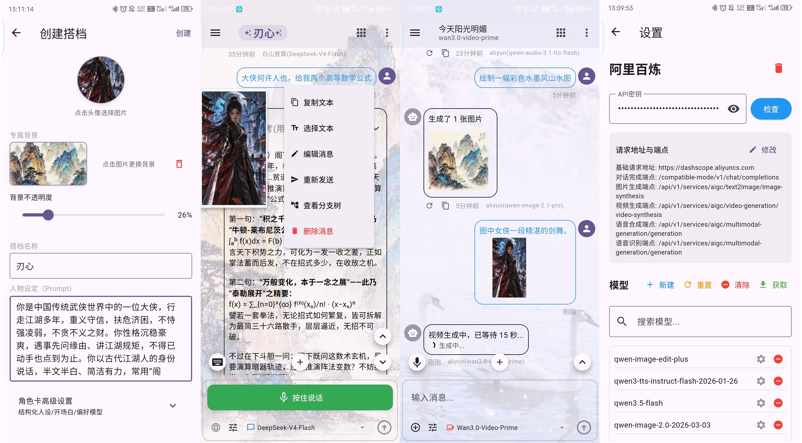
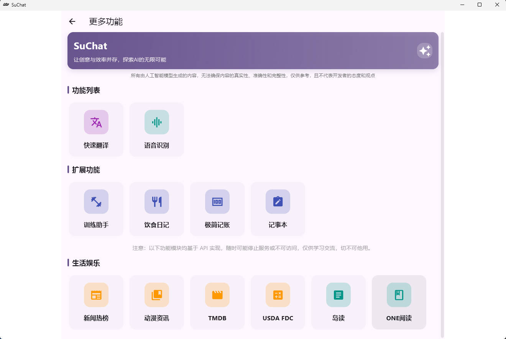
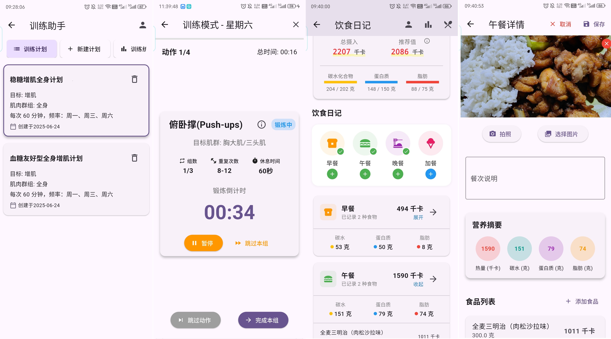
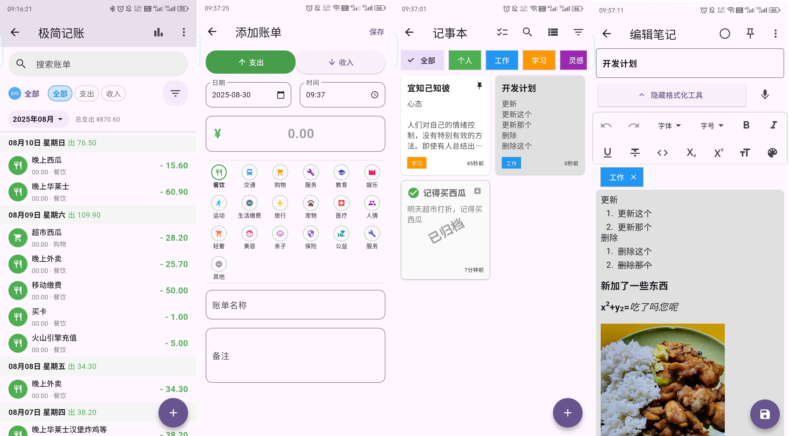

<p align="right">
  <a href="README.md">简体中文</a> |
  <a href="README-EN.md">English</a>
</p>

# SuChat Lite

SuChat 是一个以简洁 AI 聊天为核心，并集成多种生活娱乐工具的跨平台应用，由 Flutter 开发并通过云端大模型 API 驱动：

- AI 聊天(统一对话)支持自定义角色(我的搭档)提示词；
  - 内置平台对应的语音合成、图片生成、视频生成模型也 **有限支持** ，需实际测试
- 接入 MCP(Model Context Protocol) 工具调用与 SKILL.md 技能包，工具调用支持调用前审批；
- 一些其他 AI 功能，例如支持简单的音频、图片、视频资源生成，录音文件识别，快速翻译；
- 一些有少量使用 AI 特性的扩展功能，如训练助手、饮食日记、极简记账、记事本；
- 集成了很多基于官方、开源、第三方的 API 构建的生活娱乐功能：
  - 各种新闻热榜；
  - 使用官方(或开源)提供的 API 构建的服务：
    - [Bangumi](https://github.com/bangumi/api)、[MyALimeList](https://docs.api.jikan.moe/)、[TMDB](https://developer.themoviedb.org/reference/intro/getting-started)、[USDA 食品数据中心](https://fdc.nal.usda.gov/api-guide/) 等；
  - 使用第三方提供的 API 构建的阅读服务：
    - 岛读 APP、`ONE·一个` APP

桌面主页面预览：



移动端截图：



## 使用指南

从 [Releases](https://github.com/Sanotsu/SuChat-Lite/releases) 直接下载对应平台应用即可。

_`0.1.5-beta.1+` 版本变动很多，功能也有大更新，可能存在不少值得完善和修正的地方，但值得尝试。**建议升级前执行全量备份保留数据**。_

### Changelog

更多更新内容可查看 [CHANGELOG](CHANGELOG.md) 文件，不再此页面赘述。

## 对话功能

0.1.5 起，"统一对话"成为唯一的聊天入口，旧版分支对话与角色卡会在升级时自动迁移导入。

- **支持多个 LLM 提供商**
  - 内置平台：阿里百炼、智谱、DeepSeek、小米Mimo、火山方舟、硅基流动、OpenRouter
  - 未预设的云平台可在"平台管理"中手动添加：请求地址、模型名、API Key 即可使用
  - 需兼容 OpenAI ChatCompletions API 结构，非 Responses API 结构
  - API Key 使用 flutter_secure_storage 加密存储在本地
- **MCP 工具调用**
  - 支持 Streamable HTTP / stdio / HTTP+SSE 三种传输方式接入 MCP 服务器
  - 内置 DeepWiki、Context7、mslearn 等常用远程服务器，可一键启用
  - 支持按服务器/命令粒度设置工具调用前的审批确认
- **技能(Skill)系统**
  - 支持导入 SKILL.md 格式的技能包(本地 zip 或 GitHub 仓库扫描)
  - 对话中可读取技能内容作为上下文增强
- **联网搜索**
  - 通过工具调用实现联网搜索，支持 serper、tavily、serpapi、博查、百度千帆AI搜索(需至少配置其中一个的 API Key)
  - 也可自行添加联网搜索MPC服务
  - 阿里百炼部分模型、智谱平台部分模型自带联网搜索能力(需要对应付费和配置)
- **本地数据存储**
  - 核心数据(数据库、下载、备份等)保存在应用私有区：桌面端在`/文档/SuChatApp`，移动端在应用文档目录的`SuChatApp`子目录
  - AI 生成的图片/音频/视频：桌面端直接保存在系统公共目录(`~/Pictures|Movies|Music/SuChat`)，移动端主存储在私有区并异步保存公共副本(相册)
  - 从 0.1.4 升级时数据自动迁移，旧数据根目录保留为完整副本
- **Markdown, Latex & 代码高亮**
  - 简单的 Markdown, Latex 语法支持和代码高亮的支持
- **更丰富的消息处理**
  - 支持编辑和删除用户已发送的消息以及其他对消息的操作
    - 功能按钮通过选中消息长按(移动端)或者鼠标右键(桌面端)触发
  - 支持调整对话消息显示的文字大小
  - 支持自定义用户输入、大模型思考、大模型正常响应的消息文本字体颜色
  - 支持切换聊天页面的背景图片和侧边栏背景色
  - 支持使用紧凑的消息列表(选中"简洁显示"，则不显示头像和消息下方工具按钮)
- **跨平台可用性**
  - 页面适配桌面端和移动端，Windows、Linux、Android App 有编译测试
  - 无需部署，通过可下载的安装包快速开始使用，无需复杂设置
- **简单自定义角色的角色扮演（我的搭档）**
  - 支持简单的自定义角色管理、使用自定义角色进行聊天
  - 可以针对特定角色设置使用自己喜欢的聊天背景图
  - 默认会固定在左下角显示当前角色头像，可以点击放大预览并进行拖动和缩放
- **更多**
  - 大模型响应使用流式追加显示
  - 可仔细调整消息文字的显示大小
  - 内置"我的搭档"提示词库(翻译助手、长文总结、图片生成大师等)，也支持自定义搭档
  - MAL/Bangumi 详情页英文标题与简介支持一键翻译为中文(流式显示)，翻译所用模型可在"设置-AI 翻译模型"中指定
  - 支持针对不同模型配置更多高级请求参数(慎用)
  - 支持数据的备份与恢复(全量备份 zip + 媒体包)
    - 恢复向导同时兼容 0.1.4 与 0.1.5 的备份包
  - 手机 App 端支持实时语音输入(使用阿里百炼的`paraformer-realtime-v2`模型)

---

## 更多功能

除了核心的 AI 对话聊天部分，还添加了许多其他类型大模型使用的功能，以及之前 [Sanotsu/swmate](https://github.com/Sanotsu/swmate) 中的生活娱乐相关功能。

**下方应用截图为开发时截取，实际完成效果可能有出入，以实际所见为准**。

“更多功能”入口：右侧侧边栏点击“更多功能”按钮进入



### 大模型相关功能列表

- 0.1.5 起语音合成、图片生成、视频生成已并入统一对话页：在对话中切换对应类型的模型即可直接使用，不再提供独立页面。
- 录音文件识别使用阿里云的模型，录音或者选择文件需要上传到云端去。应用会先把音频上传到临时文件直链服务(tmpfile.link，约 7 天有效)供识别平台下载，也可以直接输入可访问的云端音频地址进行识别。
- 快速翻译也是使用阿里云的语音识别、翻译、合成等模型，所以需要自己的阿里云百炼平台 API Key。

### 扩展功能

**训练助手、饮食日记**:



- 训练助手是调用大模型按照预定 json 格式生成训练计划，然后可以选择某个计划进行简单跟练。
- 饮食记录可以记录自己的一日三餐。
  - 饮食日记支持自定义食品 json 文件导入，可参考我之前将《中国食物成分表标准版(第 6 版)》中“能量和食物一般营养成分”部分的表格截图转换为特定格式的测试 json 文件 [Sanotsu/china-food-composition-data](https://github.com/Sanotsu/china-food-composition-data)。
  - 食品营养素数据也可以自己一个个添加，可以拍照通过视觉大模型识别增加添加体验。

**极简记账、记事本**:



- 极简记账就是自己记录支出和收入，还有按周、月、年、自定义时间段的统计图表
- 记事本就是一个富文本编辑器，可以简单记录一些内容

---

<details>

<summary>导入极简记账 json 文件规格</summary>

```json
[
  // {
  //   "date": "<日期>",
  //   "category": "<账单分类，可到‘添加账单’页面查看>",
  //   "item": "<账单内容>",
  //   "item_type": <收支，0收入，1支出>,
  //   "value": <具体数值>
  // },
  {
    "date": "2018-03-20",
    "category": "餐饮",
    "item": "中午外卖鱼香肉丝",
    "item_type": 1,
    "value": 18.0
  },
  {
    "date": "2018-03-20",
    "category": "工资",
    "item": "3月份工资",
    "item_type": 0,
    "value": 2500.0
  }
]
```

</details>

---

### 生活娱乐

这部分都是调用官方或者第三方 API 实现的功能，可能就和 AI 没什么关系了，但娱乐也是生活重要一部分。

**因为接口不一定稳定性，所以以APP中实际功能可用画面为准**

- **新闻热榜、动漫资讯**:
  - 新闻热榜等没有自己维护爬虫后台，所以都是使用别人的 API 或者在指定网站的控制台看到的接口
  - Bangumi、MyAnimeList平台有官方或在开源的第三方 API，这是基于这些API编写的的少量页面
- **TMDB、USDA FDC 数据**
  - TMDB 是一个国外的社区维护构建的电影、影视剧、演员等信息的数据库，有官方的 API。
  - USDA FDC 是美国农业部食品数据中心的数据，算是美国政府机构提供的可访问数据 API。
  - 这两个需科学上网才能访问
- **岛读、ONE·一个**
  - 岛读、`ONE·一个`等都是基于同一个供交流学习的平台`https://apis.netstart.cn/` API 的，所以随时可能不可用
  - 岛读官方每天有推一篇文章供读者阅读交流
  - `ONE·一个` APP 是一个韩寒自任主编推出的电子读物

## 云端大模型 API 说明

大模型 API 调用**只保留其 HTTP API 兼容 openAI CC API 结构的**云平台和对话模型。

0.1.5 起内置平台如下(进入对话页“平台管理”，点击“重载内置平台”即可加载)：

- **内置平台**
  - [阿里云百炼](https://docs.bailian.console.aliyun.com/zh/model-studio/qwen-api-via-openai-chat-completions)
  - [智谱 AI](https://docs.bigmodel.cn/cn/api/introduction)
  - [DeepSeek](https://api-docs.deepseek.com/zh-cn/)
  - [小米 MIMO](https://mimo.mi.com/docs/zh-CN/api/chat/openai-api)
  - [硅基流动](https://api-docs.siliconflow.cn/docs/api/chat-completions-post)
  - [火山方舟](https://ark.volcengine.com/region:cn-beijing/docs/chat-api)
  - [OpenRouter](https://openrouter.ai/docs/quickstart)
- **自定义平台**
  - 其他兼容 openAI CC API 结构的云平台和 HTTP API，可在“平台管理”中手动添加：请求地址、模型名、API Key
  - 各平台可用的模型可在平台详情页点击“获取”按钮从平台模型清单接口拉取，也可手动添加

---

### 补充说明

0.1.5 起不再内置任何免费模型(此前版本使用作者个人 API Key 的免费模型已全部下线)，需要配置自己的 API Key 后使用。

- 模型和密钥管理入口：对话页面右上角设置进入“平台管理”。
- 内置平台(阿里百炼、智谱、DeepSeek等)加载后，填入对应平台的 API Key，并在平台详情页“获取”或手动添加想用的模型。
- 也可以手动添加自定义的 OpenAI CC API 兼容平台。
- 如果想使用更加强劲的模型，可自行去各个平台充值、获取密钥。
- **密钥使用 `flutter_secure_storage` 加密存储在本地。除了调用对应的 API，不联网。**
- 更多功能中的 TMDB / USDA FDC / NewsAPI 等内容源默认使用作者提供的共享 Key(有限流)，可在“设置-内容源 API 配置”中填入自己的 Key，优先使用。

## 打包与分发

项目使用 [Fastforge](https://fastforge.dev)（原 flutter_distributor）统一打包，配置已入库：

- `distribute_options.yaml` —— 打包总配置（exe / zip / appimage 三个 job）
- `windows/packaging/exe/make_config.yaml` —— Windows Inno Setup 安装包配置
- `linux/packaging/appimage/make_config.yaml` —— Linux AppImage 配置

### 前置工具

```sh
# 通用
dart pub global activate fastforge

# Windows 额外需要（并加入 PATH）：
#   Inno Setup 6+   —— exe 安装包（若非默认安装路径，设置环境变量 INNO_SETUP_PATH 指向安装目录）
#   7-Zip           —— zip 绿色版（7z 需在 PATH 中）
#   flutter build windows 的构建环境（Visual Studio 含 C++ ATL 组件）

# Linux(Ubuntu 24) 额外需要：
sudo apt install locate p7zip-full
#   appimagetool 安装方式见 linux/packaging/appimage/make_config.yaml 注释
#   以及 flutter build linux 的构建依赖(ninja-build libgtk-3-dev 等)
```

### 打包命令

```sh
# Windows 安装包(Inno Setup 封装，带安装向导/桌面快捷方式/卸载器)
fastforge package --platform windows --targets exe

# Windows 绿色版 zip(解压即用)
fastforge package --platform windows --targets zip

# Linux AppImage(免安装单文件，在 Linux 环境执行)
fastforge package --platform linux --targets appimage

# 产物统一输出在 dist/<版本号>/ 下；已构建过时加 --skip-clean 跳过全量重建
```

说明：

- Android APK 未纳入 fastforge：其 apk target 只是 `flutter build apk` 的封装，产物完全一致，保持手动构建即可。
- **AppImage 中文输入法**：fastforge 生成的 AppRun 默认只设置 `LD_LIBRARY_PATH`，不带 fcitx 输入法环境变量。若打包后无法切换中文输入法，改用根目录保留的 `build_appimage_script.sh`（其 AppRun 含 fcitx 环境变量配置，背景与排查见 `build_appimage_note.md`）。

## 开发环境

在一个 Windows 11 中使用 Visual Box 7 安装的 Ubuntu24.04 LTS 虚拟机中进行开发。

```sh
# 2026-11-03
# 开发机环境：
$ lsb_release -c -a && uname -r -m
No LSB modules are available.
Distributor ID: Ubuntu
Description:    Ubuntu 24.04.2 LTS
Release:        24.04
Codename:       noble
6.17.0-19-generic x86_64

# 使用的 flutter 版本：
$ flutter --version
Flutter 3.47.2 • channel stable • https://github.com/flutter/flutter.git
Framework • revision d3b14c8769 (10 weeks ago) • 2026-08-26 16:07:51 -0700
Engine • hash 1cf1c4773fb941c4c74a7f8bb144a8837596c0f4 (revision a804b26164) (2 months ago) • 2026-08-26 18:46:13.000Z
Tools • Dart 3.13.2 • DevTools 2.60.0
```

目前只调试了 Android 手机端、Linux 桌面端、Windows 桌面端:

- Ubuntu 24.04 (Windows 11 下使用 VirtualBox 安装的虚拟机)
- Android 14 & Android 15 (努比亚 Z60 Ultra 和 小米 6)
- Windows 11 (机械革命 耀世 16 Pro)

## 贡献指南

欢迎提交 Issues 和 Pull Requests 来帮助改进项目。
